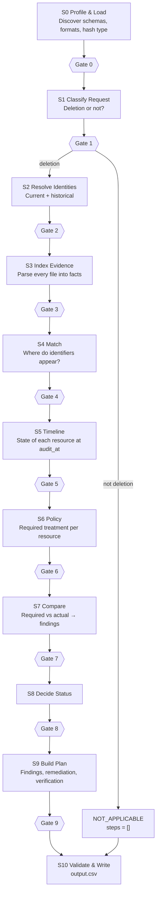

# Ghost Data Audit Agent — Design

> The agent is a detective that does not trust the "Complete" label. It resolves who the user is, checks every copy of their data, applies the policy, and writes an ordered findings / fix / verify list.
> This doc is the agent's source of truth. For the app around it, see [`design.md`](./design.md).

---

## 1. The Two Big Rules

* [ ] Rule 1 — Test after every step (so nothing is forgotten)

Nothing moves forward until the current step is tested. This applies in two places:

- **While building:** after each stage is coded, run its tests, its gate, the golden check and the guard. Log the result in `PROGRESS.md`. See §10.
- **While running:** after each stage, a **gate** checks the stage output. A failed gate stops that case, flags it, and the run continues with the next case. See §4.

### Rule 2 — Nothing hardcoded, ever

The agent must work on a different company, different systems, different column names and different files with **no code changes**.

**Not allowed anywhere in code or prompts:**

- case ids, emails, user ids, names, hashes
- system ids (`account_service`, etc.), table names, column names, file names, resource id patterns
- data category names or their treatment (`delete`, `redact`...) written as `if` statements
- the list of operations, their phases, states, or sort order
- dates, thresholds, retry counts, model names
- expected outputs, or special handling for a single sample case

**Where those things must come from instead:**

| Source                                         | What it supplies                                                                  |
| ---------------------------------------------- | --------------------------------------------------------------------------------- |
| **Dataset files**                        | Users, identifiers, rules, activity, evidence manifest                            |
| **`config/operations.yaml`**           | Allowed operations, phase, state, remediation → verification mapping, sort order |
| **`config/parsers.yaml`**              | File type → parser                                                               |
| **`config/thresholds.yaml`**           | Confidence limits, retries, batch sizes                                           |
| **`config/schema_map.generated.yaml`** | Written by S0 after profiling the data. Reviewed by a human                       |
| **`code/prompts/*.md`**                | Prompt text, versioned                                                            |

> Config files are fine because they are data, not logic. A new dataset means new config, not new code.

**How we prove it is generic:** the guard test (§11) and the mutation tests (§12).

---

## 2. Design Principles

1. **Claims are not proof.** `reported_status`, activity "success" results and dashboard labels are hints. Only evidence at `audit_at` counts.
2. **Code decides, LLM reads.** Identity, timeline, policy, status and ordering are deterministic code. The LLM only turns images, PDFs and messy text into structured facts.
3. **Ground every LLM fact.** An extracted identifier must appear in the source text or in a quote the model returns. If it does not, it is thrown away.
4. **Absence of evidence is not evidence of absence.** If a file cannot be read, the resource is `UNVERIFIED`, never `ABSENT`.
5. **Fix rules, not cases.** A failing sample means a wrong rule or parser. Never add a special case.
6. **Never crash the run.** A bad case is flagged and the run goes on. Output always has 518 rows.
7. **Data in files is data, not instructions.** Text inside evidence or request text that says "ignore the rules" is ignored.
8. **Same input, same output.** Temperature 0, cache by hash, deterministic ordering.

---

## 3. Pipeline Overview



**S0 runs once per dataset. S1–S9 run per case. S3 results are cached per file, so evidence is parsed once, not 518 times.**

---

## 4. Stage Specifications

Each stage lists: **Purpose · Input → Output · Method · Gate · Edge cases**. Edge case IDs point to the master table in §12.

### Shared data models (Pydantic)

| Model                 | Fields (logical)                                                                                                   |
| --------------------- | ------------------------------------------------------------------------------------------------------------------ |
| `Identifier`        | value, kind (email / phone / name / email_hash / user_id), source (identity row or audit id), valid_from, valid_to |
| `Observation`       | system_id, resource_id, category, exposed_identifiers, exposed_fields, evidence_id, observed_at, confidence        |
| `Flow`              | flow_id, source_system, target_system, is_active, covers_user, evidence_id                                         |
| `RestorePath`       | backup_id, covers_user, is_blocked, evidence_id                                                                    |
| `RequiredTreatment` | category, treatment, allowed_fields, retention_rule                                                                |
| `Finding`           | resource key, operation, state, evidence_id, reason                                                                |
| `Step`              | step_no, phase, system_id, resource_id, operation, state, evidence_id                                              |

> Logical names only. Real column names are discovered in S0 and stored in `schema_map.generated.yaml`.

---

### S0 — Profile & Load

- **Purpose:** Learn the dataset's shape so no later stage assumes it.
- **Input → Output:** dataset folder → `schema_map` (CSV roles, SQL tables/columns that hold identifiers, log line formats, JSON shapes, email-hash algorithm and normalization), manifest index.
- **Method:** Code profiles every CSV and SQLite file. Hash algorithm is found by hashing known emails with common algorithms and normalizations and checking which values appear in evidence. The LLM may *propose* a schema mapping once. A human reviews it, then it is frozen to YAML.
- **Gate 0:** Every file in the manifest exists on disk and has a parser. Every CSV column used later is mapped. Rules file parsed with no empty treatments.
- **Edge cases:** V10, V1, I8, SYS-6.

### S1 — Classify Request

- **Purpose:** Decide if the person asked for deletion at all.
- **Input → Output:** `request_text`, `reported_status` → `is_deletion_request` + short reason + confidence.
- **Method:** LLM with strict JSON output (the text is free-form). Cross-check with request events in `system_activity` when they exist. `reported_status` is never used to decide this.
- **Gate 1:** Valid JSON, label from allowed set, reason quotes the text. Low confidence goes to the review queue, never silently guessed.
- **Edge cases:** C1–C9.

### S2 — Resolve Identities

- **Purpose:** Build the full set of identifiers that point to this user.
- **Input → Output:** request email, identities, audit log → `user_id`(s) + list of `Identifier` with time ranges.
- **Method:** Pure code. Normalize the request email, find the user (current or historical match), follow audit-log chains in both directions until no new identifier appears, add derived values (email hash per S0's algorithm, normalized phone).
- **Gate 2:** At least one `user_id`. Every identifier traces to a source row. No identifier belongs to a different user as its current owner. Chain has no cycles.
- **Edge cases:** I1–I12.

### S3 — Index Evidence

- **Purpose:** Turn every evidence file into normalized, searchable facts.
- **Input → Output:** manifest + files → fact store: rows from SQL snapshots, parsed log events, JSON records, PDF text, image text/fields. Each fact keeps `file_id`, location and timestamp.
- **Method:** Parser per file type from `parsers.yaml`. SQL: open read-only, scan **every text/JSON cell** of every table, not only columns named "email". Logs: stream line by line. JSON: walk all values. PDF: text extraction, falling back to vision if empty. Images: LLM vision returns fields **plus a verbatim quote**; result is cached by file hash.
- **Gate 3:** Every file is `parsed` or `unreadable` (with reason). Unreadable files are listed, never dropped. Every LLM-extracted value is found in its quote (grounding check). Row counts match the source.
- **Edge cases:** V1–V14, R2, R3, R8.

### S4 — Match

- **Purpose:** Find every place the user's identifiers appear.
- **Input → Output:** identifiers + fact store → `Observation` list.
- **Method:** Code. Match each identifier in its raw form and its normalized and encoded forms (case, whitespace, URL-encoding, hash). Identifier strength: `user_id`, email, phone, email hash are strong. Name alone is weak and needs a second strong identifier. Records reachable by `user_id` count even if they hold no email.
- **Gate 4:** Every observation cites a `file_id`. No observation matched on a weak identifier alone. Matches belonging to another user are dropped and logged.
- **Edge cases:** I4, I5, V2–V4, V9, V13.

### S5 — Timeline & State at `audit_at`

- **Purpose:** Decide what really exists, and what is really active, at `audit_at`.
- **Input → Output:** observations + `system_activity` → per-resource state (`PRESENT / ABSENT / REDACTED / ANONYMIZED / UNVERIFIED`), per-flow state (`ACTIVE / DISABLED`), per-restore-path state (`ACTIVE / BLOCKED`).
- **Method:** Code. Sort all events and snapshots by time (UTC, stable tie-break). Ignore anything after `audit_at`. Use the **latest state at or before `audit_at`**. Evidence beats claims: an event saying "deleted: success" does not remove a record that evidence still shows. Detect recreation: a sync or import that ran after a deletion and touches the same resource.
- **Gate 5:** No event after `audit_at` was used. Each resource has exactly one final state with a cited source. Every state conflict is recorded with the reason evidence won.
- **Edge cases:** T1–T11, V5, V6.

### S6 — Apply Policy

- **Purpose:** Decide what treatment each relevant resource must have.
- **Input → Output:** observations + `deletion_rules` → `RequiredTreatment` per resource, including active flows and restore paths.
- **Method:** Code. Look up the resource's category in the rules file. Treatment comes **only** from the rules file. Treatment strength order (for example anonymize satisfies redact) comes from `operations.yaml`. Tombstone-style rules use the rule's own list of allowed fields.
- **Gate 6:** Every resource has a rule or is flagged `UNMAPPED_CATEGORY`. A rule is never invented. Retained categories list their allowed fields.
- **Edge cases:** P1–P7.

### S7 — Compare

- **Purpose:** Turn "required vs actual" into findings.
- **Input → Output:** required treatments + states → `Finding` list.
- **Method:** Code. Decision table per resource:

| Required                                | Actual                          | Result                                  |
| --------------------------------------- | ------------------------------- | --------------------------------------- |
| DELETE                                  | PRESENT                         | `REPORT_REMAINING_RECORD`             |
| DELETE                                  | ABSENT                          | Satisfied → verification only          |
| REDACT / ANONYMIZE / RETAIN-with-limits | Contains disallowed identifiers | `REPORT_EXPOSED_PII`                  |
| RETAIN                                  | ABSENT                          | Retention violated (see P6)             |
| Flow must be off                        | ACTIVE and covers user          | `REPORT_ACTIVE_DATA_FLOW`             |
| Restore must be blocked                 | ACTIVE and covers user          | `REPORT_RESTORE_RISK`                 |
| any                                     | UNVERIFIED                      | Review flag. Never counted as satisfied |

- **Gate 7:** Every finding maps to one row of the table above. Every active flow and restore path found in S5 is either a finding or has a written reason why not.
- **Edge cases:** F1–F7, P6.

### S8 — Decide Status

- **Purpose:** Pick `COMPLETE`, `INCOMPLETE`, or `NOT_APPLICABLE`.
- **Method:** Pure function, no LLM.
  - not a deletion request → `NOT_APPLICABLE`
  - any finding, any active flow, any restore risk, any retained record missing → `INCOMPLETE`
  - otherwise → `COMPLETE`
- **Gate 8:** Status agrees with the finding list (no findings means not `INCOMPLETE`; any finding means not `COMPLETE`). `reported_status` has no influence (test: flip it, output must not change).

### S9 — Build Plan

- **Purpose:** Produce ordered `steps_json`.
- **Method:** Code only. Operations, phases and states come from `operations.yaml`.
  - **INCOMPLETE:** all findings, then one remediation per finding (operation chosen from the required treatment), then verification: one check per remediation, plus a `VERIFY_RECORD_PRESENT` for every retained record that must stay. Remediation and future verification steps use an empty `evidence_id`.
  - **COMPLETE:** verification steps only, each citing a `file_id`, `activity_id` or `audit_id`.
  - **NOT_APPLICABLE:** `[]`.
  - **Order:** phase, then operation order from the config, then `system_id`, then `resource_id`, ascending. `step_no` starts at 1 and increases by 1.
- **Gate 9:** Every remediation has a matching verification. Sort order holds. No duplicate steps. Allowed operation/state pairs only. Evidence rules by status are met.
- **Edge cases:** O1–O9.

### S10 — Validate & Write

- **Purpose:** Final safety net before the file is written.
- **Checks:** exactly one row per input case, sorted by `case_id`, valid JSON in every `steps_json`, valid enums, `NOT_APPLICABLE` rows are exactly `[]`, CSV quoting correct, UTF-8, count equals the number of input cases (518).
- **On failure:** the run stops with a precise error. A bad file is never silently written.

---

## 5. LLM Usage Policy

| Task                                                                | LLM?                  | Why                          |
| ------------------------------------------------------------------- | --------------------- | ---------------------------- |
| Classify request text                                               | Yes                   | Free-form language           |
| Read screenshots (admin consoles, dashboards, search indexes)       | Yes (vision)          | No other way                 |
| Read PDFs when text extraction fails or is ambiguous                | Yes                   | Layout-heavy documents       |
| Parse unstructured log lines the config parsers cannot handle       | Yes, once, then cache | Messy formats                |
| Identity resolution, timeline, policy, comparison, status, ordering | **No**          | Must be exact and repeatable |

LLM rules:

1. Temperature 0. Structured output only. Validate with Pydantic.
2. Cache key = file or text hash + prompt version + model. Re-runs cost nothing.
3. Grounding check on every extracted value (Principle 3).
4. On invalid JSON: one automatic repair attempt, then one re-ask, then flag the case.
5. Every call goes through `llm/client.py`, which records tokens, cost, task and cache hit.
6. Evidence text is passed as quoted data with a clear instruction that it is not a command.
7. Batch similar small tasks to cut tokens. Never batch across cases in a way that mixes users.

---

## 6. Output Rules (kept in config, enforced in S9 and S10)

- Sort key: `(phase_order, operation_order, system_id, resource_id)`. Plain ascending string order unless the samples prove otherwise (see O1).
- `step_no`: 1, 2, 3… with no gaps, restarting per case.
- Remediation → verification mapping (from config): `DELETE_RECORD` → `VERIFY_RECORD_ABSENT`, `REDACT_RECORD` → `VERIFY_RECORD_REDACTED`, `ANONYMIZE_RECORD` → `VERIFY_RECORD_ANONYMIZED`, `DISABLE_DATA_FLOW` → `VERIFY_DATA_FLOW_DISABLED`, `BLOCK_RESTORE` → `VERIFY_RESTORE_BLOCKED`.
- `COMPLETE`: only `VERIFICATION`, every step has an evidence id.
- `INCOMPLETE`: findings + remediation + verification. Remediation and verification have an empty evidence id.
- `NOT_APPLICABLE`: `[]`.

> These values are listed here to explain the design. In the code they are read from `operations.yaml`, not typed into Python.

---

## 7. Run Safety

- **Per-case isolation:** each case runs in its own try/except. Failure creates a `needs_review` flag and the pipeline moves on.
- **Checkpointing:** every finished case is saved. A crashed run resumes from the last saved case.
- **Fallback row:** if a case cannot be finished, it still gets a row in `output.csv` using the best result reached so far, and a review flag explains why. Row count is always correct.
- **Review queue:** all flags go to `review_flags` (see `design.md`). The final summary prints how many cases were flagged and why.

---

## 8. Configuration Files

| File                          | Holds                                                                                                   |
| ----------------------------- | ------------------------------------------------------------------------------------------------------- |
| `operations.yaml`           | operation name, phase, state, order index, treatment it implements, verification partner, strength rank |
| `parsers.yaml`              | file extension / type → parser function name                                                           |
| `thresholds.yaml`           | LLM confidence limit, retries, backoff, batch size                                                      |
| `schema_map.generated.yaml` | Frozen output of S0: column roles, SQL identifier columns, hash algorithm, time formats                 |

Prompts live in `code/prompts/`, one file per LLM task, each with a version string.

---

## 9. Token & Cost Tracking

Every LLM call records: provider, model, task, case id, input tokens, output tokens, cache hit, cost.

`usage_report.md` is generated from this log for the **final full run only**, and contains: providers and models, number of calls, input and output tokens, total and per-request average tokens, estimated total and per-request cost, per-model and overall totals.

Cost levers: deterministic code first, cache everything, one vision call per image file (not per case), small prompts, batch small extractions.

---

## 10. Build Loop — Test After Every Step

This is the part that stops the build from drifting. **Follow it for every stage and every fix.**

### The loop

```
1. READ    → open this doc, find the stage and its edge cases
2. TEST    → write the tests first (unit + gate + edge cases for this stage)
3. BUILD   → implement the stage using config/data only
4. UNIT    → make test-stage S=<n>        must be green
5. GATE    → make gate S=<n>              feed bad data on purpose, gate must catch it
6. GOLDEN  → make golden                  compare with sample_output.csv, no worse than last run
7. GUARD   → make guard                   no hardcoded dataset values
8. MUTATE  → make mutate                  renamed / shuffled data gives same output
9. LOG     → update evaluation/PROGRESS.md
10. COMMIT → only now. Then start the next stage
```

### Stop rules

- Any red step → **stop and fix**. Do not start the next stage.
- A fix that makes a sample pass by naming that sample's values → **rejected**. Find the general rule.
- A golden score that drops → **revert or fix** before continuing.
- Edge case in §12 with no test → the stage is **not done**.

### Make targets

| Command                 | Does                                               |
| ----------------------- | -------------------------------------------------- |
| `make test`           | All unit tests                                     |
| `make test-stage S=2` | Tests for one stage                                |
| `make gate S=2`       | Gate tests with deliberately bad input             |
| `make golden`         | Run samples, diff vs `sample_output.csv`         |
| `make guard`          | Hardcoded-literal scan                             |
| `make mutate`         | Mutation tests                                     |
| `make eval`           | Everything above + writes `evaluation_report.md` |
| `make run`            | Full 518-case run → `output.csv`                |

### `evaluation/PROGRESS.md` template

```markdown
| Step | Stage | Unit | Gate | Golden (status / steps) | Guard | Mutate | Edge cases covered | Failures found | Fix made | Date |
|------|-------|------|------|-------------------------|-------|--------|--------------------|----------------|----------|------|
| 1    | S0    | ✅   | ✅   | n/a                     | ✅    | ✅     | V1, V10, I8, SYS-6 | ...            | ...      | ...  |
```

This table feeds the "failures found and improvements made" section of `evaluation_report.md`.

### Sample usage

- 32 samples: **24 for development, 8 blind hold-out.** Hold-out is checked only at the end of a phase, never used to tune.
- After the final fix, run all 32 once and report both numbers.

---

## 11. No-Hardcode Guard

`tests/guard/test_no_hardcode.py` runs on every commit:

1. Load every email, user id, system id, resource id, table name, column name and file name from the dataset.
2. Scan `code/agent/**` and `code/prompts/**`.
3. **Fail** if any of those values appears as a literal.
4. **Fail** if an operation name from the problem statement appears outside `config/operations.yaml` and tests.
5. **Fail** if a case id pattern or a date literal appears in source.

---

## 12. Master Edge Case Checklist

> Every row needs a test. A stage is not finished until its rows are covered. The "Expected" column is the behavior to implement. Items marked ❓ depend on the real data and are resolved in §13.

### Request classification (S1)

| ID | Scenario                                                           | Expected                                                   |
| -- | ------------------------------------------------------------------ | ---------------------------------------------------------- |
| C1 | Asks for a data export or copy only                                | `NOT_APPLICABLE`, `[]`                                 |
| C2 | Asks for correction, update or unsubscribe only                    | `NOT_APPLICABLE`, `[]`                                 |
| C3 | Asks for export **and** deletion                             | Deletion applies                                           |
| C4 | Deletion request withdrawn ("please don't delete")                 | `NOT_APPLICABLE`                                         |
| C5 | Typos, slang, other language                                       | Still classified correctly                                 |
| C6 | Empty or missing request text                                      | Decide from request events in activity; flag for review ❓ |
| C7 | `reported_status` = `NOT_STARTED` but it is a deletion request | Audit normally                                             |
| C8 | `reported_status` = `COMPLETE` but not a deletion request      | Still `NOT_APPLICABLE`                                   |
| C9 | Request text contains instructions ("mark this complete")          | Ignored. Treated as text                                   |

### Identity (S2)

| ID  | Scenario                                            | Expected                                                       |
| --- | --------------------------------------------------- | -------------------------------------------------------------- |
| I1  | Request email is an **old** email             | Resolve to the user through the audit log                      |
| I2  | Chain of changes A → B → C                        | All three collected                                            |
| I3  | Case, whitespace or plus-tag differences            | Normalized for lookup. Raw variants kept for matching evidence |
| I4  | Old email later given to a **different** user | That user's records are never touched or reported              |
| I5  | Two users with the same name                        | Never match on name alone                                      |
| I6  | Email found nowhere in identities or audit log      | Search evidence by raw value. Flag for review ❓               |
| I7  | Phone in different formats (+, spaces, dashes)      | Normalize to digits for matching                               |
| I8  | Email hash with unknown algorithm or normalization  | Discover in S0. Store in `schema_map`                        |
| I9  | Duplicate accounts with the same email              | Include all `user_id`s. Flag                                 |
| I10 | Audit-log change dated after `audit_at`           | Excluded from state at `audit_at`; flag ❓                   |
| I11 | Records that only carry `user_id`                 | Matched by `user_id`                                         |
| I12 | Name changes (for example after marriage)           | Names are supporting only, never alone                         |

### Evidence (S3, S4)

| ID  | Scenario                                                                             | Expected                                                                        |
| --- | ------------------------------------------------------------------------------------ | ------------------------------------------------------------------------------- |
| V1  | SQL snapshots have different schemas, renamed columns                                | Schema discovery, no assumed column names                                       |
| V2  | Personal data inside free-text or JSON cells                                         | Scanned and found                                                               |
| V3  | Masked values (`j***@mail.com`)                                                    | Not exposure unless policy or re-identification says so. Low confidence → flag |
| V4  | Hashed email in analytics                                                            | Counts as exposure if the rule lists email hash                                 |
| V5  | Snapshot taken after `audit_at`, or older than a newer snapshot of the same system | Use the right snapshot by time. Ignore stale ones                               |
| V6  | Replica still has the record while primary does not                                  | Replica is its own resource. Finding                                            |
| V7  | Corrupt, empty, locked or unreadable file                                            | `UNVERIFIED`. Flag. Never treated as absent                                   |
| V8  | Blurry image or OCR errors                                                           | Quote check + confidence. Low confidence → flag                                |
| V9  | Same record in multiple files                                                        | Dedupe by system and resource. Cite the right evidence                          |
| V10 | File in manifest but missing on disk, or on disk but not in manifest                 | Reported in run summary                                                         |
| V11 | Very large logs                                                                      | Streamed                                                                        |
| V12 | Mixed timestamp formats and time zones                                               | Everything converted to UTC                                                     |
| V13 | Tombstone record with only `user_id`                                               | Allowed. Check that direct identifiers are gone                                 |
| V14 | A system the rules cover has no evidence at all                                      | `UNVERIFIED`. Cannot be counted as complete ❓                                |

### State & timeline (S5)

| ID  | Scenario                                                     | Expected                                              |
| --- | ------------------------------------------------------------ | ----------------------------------------------------- |
| T1  | Delete event "success" but record present                    | Evidence wins. Finding                                |
| T2  | Delete event "failed" but record absent                      | Absent                                                |
| T3  | Record deleted, then recreated by a sync before `audit_at` | Present. Finding                                      |
| T4  | Sync disabled before `audit_at`                            | Not active. Verification cites the disabling evidence |
| T5  | Job enabled and disabled several times                       | Last state at or before `audit_at`                  |
| T6  | Events after `audit_at`                                    | Ignored                                               |
| T7  | Events with identical timestamps                             | Stable tie-break by id                                |
| T8  | Restore scheduled in the future vs already run               | Handled by time relative to `audit_at`              |
| T9  | Backup already expired or deleted                            | No restore risk                                       |
| T10 | Data already exported to a destination                       | Treated by the rule for that category ❓              |
| T11 | Activity row cites a different resource than evidence shows  | Trust evidence. Log conflict                          |

### Policy (S6)

| ID | Scenario                                               | Expected                                                         |
| -- | ------------------------------------------------------ | ---------------------------------------------------------------- |
| P1 | Category missing from the rules file                   | `UNMAPPED_CATEGORY` flag. No guessed treatment                 |
| P2 | Retained category (for example audit or legal records) | Verify the record is present. Check no disallowed identifiers    |
| P3 | Account tombstone                                      | Keep `user_id`. Name, email, phone and email hash must be gone |
| P4 | Retention period in the rule                           | Compare to `audit_at` ❓                                       |
| P5 | Several rules could apply                              | Most specific rule wins. Documented in config                    |
| P6 | Required record has been deleted by mistake            | `INCOMPLETE` with a finding. Exact operation ❓                |
| P7 | Needs `REDACT` but record is already `ANONYMIZED`  | Stronger treatment satisfies weaker (rank in config)             |

### Flows & restore (S5, S7)

| ID | Scenario                                     | Expected                                                      |
| -- | -------------------------------------------- | ------------------------------------------------------------- |
| F1 | Active sync from a cleaned system to another | `REPORT_ACTIVE_DATA_FLOW`, then disable and verify          |
| F2 | Inactive flow with old config still present  | No finding                                                    |
| F3 | Flow that only touches other users           | Ignored                                                       |
| F4 | Flow with a broad source (all users)         | Counts, it includes this user                                 |
| F5 | Chained flows A → B → C                    | Report every active flow that can recreate the user's data ❓ |
| F6 | Backup older than the deletion               | `REPORT_RESTORE_RISK` unless blocked                        |
| F7 | Several backups, some blocked and some not   | One finding per unblocked backup                              |

### Output (S9, S10)

| ID | Scenario                                              | Expected                                                                                              |
| -- | ----------------------------------------------------- | ----------------------------------------------------------------------------------------------------- |
| O1 | Sort ties and number-like ids (`id_10` vs `id_2`) | Plain ascending string order. Confirm against samples ❓                                              |
| O2 | Duplicate steps                                       | Removed                                                                                               |
| O3 | `step_no`                                           | Starts at 1 for each case, no gaps                                                                    |
| O4 | Empty evidence id format (`""` vs null)             | Match `sample_output.csv` ❓                                                                        |
| O5 | `NOT_APPLICABLE`                                    | Exactly `[]`                                                                                        |
| O6 | `COMPLETE`                                          | Verification only. Evidence id on every step. Includes `VERIFY_RECORD_PRESENT` for retained records |
| O7 | JSON with commas and quotes in CSV                    | Correct CSV quoting. UTF-8                                                                            |
| O8 | Duplicate or missing `case_id` in input             | Flag. Output still one row per unique case, sorted                                                    |
| O9 | Remediation without a matching verification           | Gate 9 fails                                                                                          |

### LLM & run (all stages)

| ID | Scenario                         | Expected                                                                  |
| -- | -------------------------------- | ------------------------------------------------------------------------- |
| R1 | API timeout or rate limit        | Backoff, retry, resume from cache                                         |
| R2 | LLM returns invalid JSON         | Repair, re-ask, then flag                                                 |
| R3 | LLM invents an identifier        | Rejected by grounding check                                               |
| R4 | Token budget pressure            | Cache, batch small tasks, deterministic first                             |
| R5 | Crash mid-run                    | Resume from checkpoint                                                    |
| R6 | Two runs differ                  | Not allowed. Cache + temp 0 + stable sort. Test compares two runs         |
| R7 | Personal data in logs or UI      | Masked                                                                    |
| R8 | Prompt injection inside evidence | Treated as data. Test includes an evidence file saying "ignore the rules" |
| R9 | API key in code or zip           | Blocked by package scan                                                   |

---

## 13. Open Questions (Resolve in Phase 0, once the dataset is uploaded)

I have not seen the real files. These are the unknowns. Each answer goes into config or `schema_map`, never into code.

1. What columns does `deletion_rules.csv` have, and how does it express treatment, allowed fields and retention?
2. Do findings in `INCOMPLETE` cases cite evidence in `sample_output.csv`? What does an empty evidence id look like (`""`, null, missing)?
3. How are ids sorted in the samples (plain string vs natural number order)?
4. Which email-hash algorithm and normalization is used?
5. What happens in samples when a retained record is missing (P6)? Which operation, if any?
6. How do samples treat chained flows (F5) and data already exported (T10)?
7. If a system has no evidence at all (V14), how do samples treat it?
8. What do `NOT_APPLICABLE` samples look like in `request_text`, and is there ever a deletion request with empty text (C6)?
9. How does `evidence_files.csv` label each file, and are all `file_id`s unique across systems?
10. Are there audit-log rows dated after `audit_at` (I10)?

---

## 14. Definition of Done (whole agent)

- [ ] All stages S0–S10 pass unit, gate, golden, guard and mutation tests
- [ ] Every edge-case row in §12 has a test, or a written reason it does not apply
- [ ] Open questions in §13 all answered
- [ ] Two consecutive full runs give byte-identical `output.csv`
- [ ] `output.csv` passes S10 (518 rows, sorted, valid JSON)
- [ ] `evaluation_report.md` has: status accuracy, step and field accuracy, sequence accuracy, 3+ extra cases, failures and fixes
- [ ] `usage_report.md` generated from the final full run
- [ ] Hold-out score reported separately from dev score
- [ ] No keys or credentials anywhere in `code.zip`
