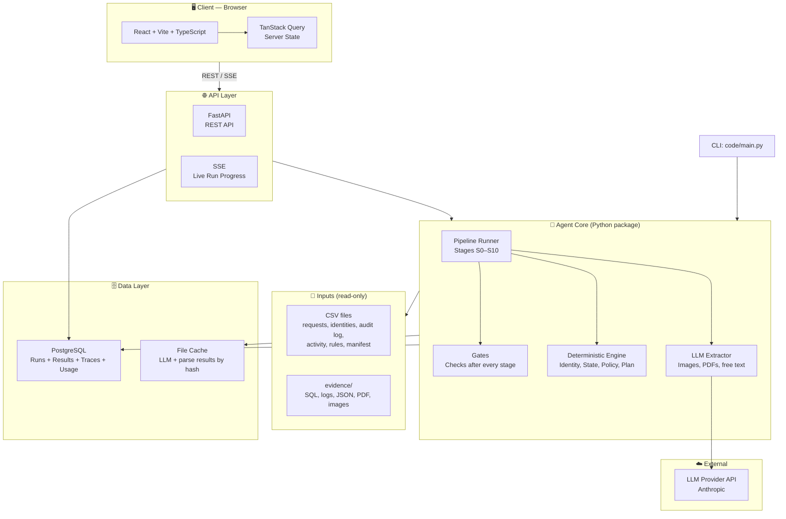
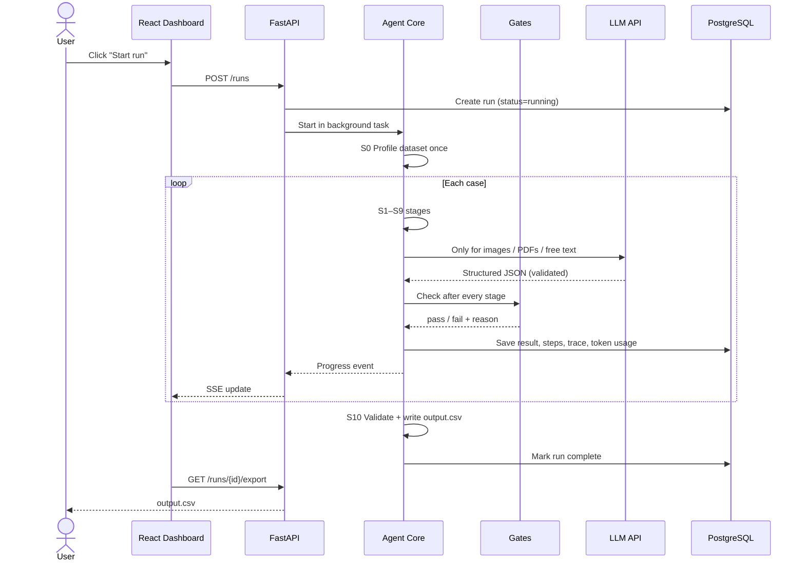
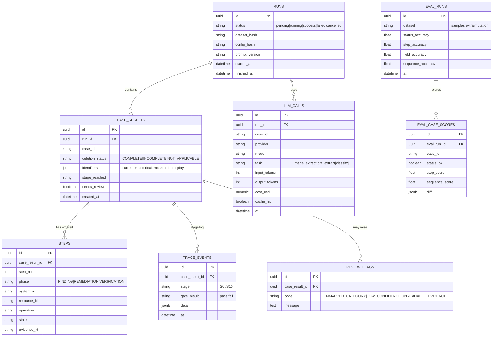

# Ghost Data Audit — Design & Architecture

> A deletion audit system for Northstar Shop. It checks whether a "deleted" customer is really gone, and writes the exact fix list when they are not.
> One core engine, three ways to use it: **CLI** (for grading), **API**, **Dashboard**.

See [`agent_design.md`](./agent_design.md) for the agent itself (pipeline, gates, edge cases). This doc covers everything around it.

---

## 1. What We Are Building

| Piece | What it does | Required by the task? |
|-------|--------------|-----------------------|
| **Agent core** (Python package) | Reads one case, investigates evidence, returns status + steps | Yes |
| **CLI** (`code/main.py`) | Runs the core on all 518 cases, writes `output.csv` | Yes |
| **Evaluation harness** | Scores the agent on the 32 samples + our own cases | Yes |
| **FastAPI service** | Starts runs, serves results | No (our choice) |
| **PostgreSQL** | Stores runs, results, traces, token usage | No (our choice) |
| **React dashboard** | Shows cases, steps, scores, cost | No (our choice) |

**Golden rule:** the graders only look at `output.csv`, `code.zip`, the evaluation report and the usage report. So the core and the CLI must work **without** Postgres, React or a running server. The API and dashboard are wrappers around the same core.

---

## 2. High-Level Architecture



---

## 3. Data Flow — One Audit Run



---

## 4. Directory Structure

```
ghost-data-audit/
├── dataset/                       # Provided files (read-only, never edited)
├── output.csv                     # Final submission file (repo root)
├── README.md
├── Makefile                       # make test | gate | eval | guard | run
│
├── code/
│   ├── main.py                    # CLI entrypoint: run all cases → output.csv
│   ├── agent/                     # THE CORE (no web, no DB imports here)
│   │   ├── pipeline.py            # Runs stages in order, calls gates
│   │   ├── models.py              # Pydantic models: Identifier, Observation, Flow, Finding, Step
│   │   ├── stages/
│   │   │   ├── s0_profile.py      # Discover schemas, formats, hash algorithms
│   │   │   ├── s1_classify.py     # Deletion request or not
│   │   │   ├── s2_identity.py     # Current + historical identifiers
│   │   │   ├── s3_evidence.py     # Parse every evidence file into facts
│   │   │   ├── s4_match.py        # Find where identifiers appear
│   │   │   ├── s5_timeline.py     # Resource state at audit_at
│   │   │   ├── s6_policy.py       # Required treatment per resource
│   │   │   ├── s7_compare.py      # Findings = required vs actual
│   │   │   ├── s8_status.py       # COMPLETE / INCOMPLETE / NOT_APPLICABLE
│   │   │   ├── s9_plan.py         # Ordered steps
│   │   │   └── s10_output.py      # Validate + write CSV
│   │   ├── parsers/               # One parser per file type (sql, log, json, pdf, image)
│   │   ├── llm/
│   │   │   ├── client.py          # Provider wrapper + retry
│   │   │   ├── cache.py           # Cache by content hash + prompt version + model
│   │   │   └── usage.py           # Token + cost tracker
│   │   └── gates/                 # Runtime checks, one file per stage
│   ├── api/                       # FastAPI wrapper (imports agent/)
│   │   ├── main.py
│   │   ├── routes/                # runs.py, cases.py, eval.py, health.py
│   │   ├── models/                # SQLAlchemy models
│   │   ├── schemas/               # Pydantic request/response
│   │   └── migrations/            # Alembic
│   ├── prompts/                   # Versioned prompt files (one per LLM task)
│   └── config/
│       ├── operations.yaml        # Allowed operations, phases, states, sort order
│       ├── parsers.yaml           # File type → parser mapping
│       ├── thresholds.yaml       # Confidence limits, retry counts
│       └── schema_map.generated.yaml   # Written by S0, reviewed by a human
│
├── frontend/                      # React + Vite app
│   └── src/
│       ├── pages/                 # Runs, RunDetail, CaseDetail, Eval, Usage, Review
│       ├── components/            # StepsTable, IdentityTimeline, EvidenceList, StatusBadge
│       ├── api/                   # Typed API client
│       └── hooks/                 # useRunProgress (SSE)
│
├── evaluation/
│   ├── evaluation_report.md       # Required deliverable
│   ├── usage_report.md            # Required deliverable
│   ├── extra_cases/               # Our own test cases (3 minimum)
│   ├── mutation_tests/            # Renamed systems, shuffled columns, etc.
│   └── PROGRESS.md                # Step-by-step test log (see agent_design.md §10)
│
├── tests/
│   ├── unit/                      # Per stage
│   ├── gates/                     # Gate behavior
│   ├── golden/                    # Samples vs sample_output.csv
│   └── guard/                     # No-hardcode guard test
│
├── docker-compose.yml             # Postgres + API + Frontend (optional)
└── .env.example                   # Placeholders only. Never real keys.
```

---

## 5. Tech Stack (Only What Matters)

### Agent core (required)

| Tech | Role | Why |
|------|------|-----|
| **Python 3.11+** | Main language | Best fit for data + LLM work |
| **Pydantic v2** | Validate every model and every LLM output | Catches bad data early |
| **pandas** | Read and join the CSV files | Simple and fast for 518 rows |
| **sqlite3** (built in) | Open the SQL snapshot evidence | Snapshots are SQLite-compatible |
| **pdfplumber** (or PyMuPDF) | Text from PDFs | Needed for legal registers and reports |
| **Anthropic SDK** | Vision + structured extraction | Reads screenshots and messy text |
| **LangGraph** | Runs the stage graph with a gate after each node | Natural fit for "check after every step" |
| **PyYAML** | Load config files | Keeps rules out of code |
| **pytest** | All tests | Standard |

### Your chosen stack (wrapper)

| Tech | Role | Notes |
|------|------|-------|
| **FastAPI** | API to start runs and read results | Imports `agent/` directly |
| **PostgreSQL** | Runs, results, traces, usage | Optional at run time. CLI works without it |
| **SQLAlchemy + Alembic** | ORM + migrations | Standard pair |
| **React + Vite + TypeScript** | Dashboard | |
| **Tailwind CSS** | Styling | |
| **TanStack Query** | Fetch + cache API data | Replaces a global store |
| **Docker Compose** | One command to run Postgres + API + UI | |

### Deliberately skipped

| Tech | Why we skip it |
|------|----------------|
| Redis + Celery | 518 cases is a batch job. FastAPI background task + asyncio is enough |
| LangChain | We call the SDK directly. Fewer moving parts, easier token counting |
| pgvector / embeddings | Identifier matching must be exact and explainable. Vectors add guesswork |
| Temporal, Composio, Playwright | Nothing here needs them |
| JWT / OAuth | Local audit tool. Add a simple token only if deployed publicly |
| Zustand, Monaco, React Flow | The UI shows tables and timelines, not a node canvas |

---

## 6. Database Schema (Postgres)

> Postgres stores results for the dashboard. The CLI also saves the same data as JSON files, so Postgres is never required to produce `output.csv`.



**Privacy note:** this tool handles personal data. The database, logs and UI show identifiers **masked** (for example `a***@example.com`). Raw values stay only in the input files.

---

## 7. API Reference

| Method | Path | Purpose |
|--------|------|---------|
| `GET` | `/health` | Liveness check |
| `GET` | `/ready` | DB + config + dataset readable |
| `POST` | `/runs` | Start a run. Body: `{ "case_ids": [...] \| null, "use_cache": true }` |
| `GET` | `/runs` | List runs |
| `GET` | `/runs/{id}` | Run status + counts per status |
| `POST` | `/runs/{id}/cancel` | Stop a running run |
| `GET` | `/runs/{id}/events` | SSE: live progress per case |
| `GET` | `/runs/{id}/cases` | List cases. Filters: `status`, `needs_review` |
| `GET` | `/runs/{id}/cases/{case_id}` | Full result: steps, identifiers, trace, evidence |
| `GET` | `/runs/{id}/export` | Download `output.csv` |
| `GET` | `/runs/{id}/usage` | Tokens + cost, per model and total |
| `POST` | `/eval` | Run evaluation. Body: `{ "dataset": "samples" \| "extra" \| "mutation" }` |
| `GET` | `/eval/{id}` | Metrics + per-case diffs |

---

## 8. Dashboard Pages

| Page | Shows |
|------|-------|
| **Runs** | List of runs, status, start button |
| **Run detail** | Progress bar, counts of COMPLETE / INCOMPLETE / NOT_APPLICABLE, review queue count |
| **Case detail** | Identity timeline (old → new), evidence list, the steps table, gate results per stage |
| **Eval** | Four accuracy numbers, per-case diff against expected output |
| **Usage** | Tokens and cost per model, per request average |
| **Review queue** | Cases the agent flagged and why |

---

## 9. Configuration & Secrets

- **No hardcoding anywhere.** Operation names, phases, sort order, file-type parsers, thresholds all live in `code/config/*.yaml` or come from the dataset itself.
- `.env.example` has placeholders. Real keys are read from environment variables only.
- The final `code.zip` is checked for secrets before packaging (`make package` runs a scan).
- Every run stores `dataset_hash`, `config_hash` and `prompt_version`, so any result can be reproduced.

---

## 10. Testing Strategy

| Level | What | When it runs |
|-------|------|--------------|
| **Unit** | Each stage with small fixtures | Every change |
| **Gate** | Each runtime gate catches bad input (we feed bad data on purpose) | Every change |
| **Golden** | Core output vs `sample_output.csv` | After every stage is added |
| **Hold-out** | 8 of the 32 samples kept blind, checked only at milestones | Phase ends |
| **Extra cases** | At least 3 of our own, written by hand | Every eval |
| **Mutation** | Rename systems, shuffle columns, change email casing. Output must match | Every eval |
| **Guard** | Scans source for dataset-specific literals | Every commit |
| **API smoke** | pytest + httpx on health, run, export | Phase 4+ |

Full per-step rules are in `agent_design.md` §10.

---

## 11. Phased Implementation Plan

> Build the core first. The UI comes last. Each phase ends with a **test gate**: if it is red, do not start the next phase.

### Phase 0 — Look at the data (Day 1)
**Goal:** Stop guessing. Know the real formats.

- [ ] Upload the dataset and evidence files
- [ ] Profile every CSV (columns, types, sample values)
- [ ] Open one file of every evidence type (SQL, log, JSON, PDF, image)
- [ ] Read `deletion_rules.csv` fully
- [ ] Study all 32 samples: one of each status, plus the strangest ones
- [ ] Answer the open questions in `agent_design.md` §13

**Test gate:** Open questions list is empty or each item has a written decision.

### Phase 1 — Core pipeline on samples (Day 2–5)
**Goal:** Stages S0–S10 working, one at a time

- [ ] Add one stage → write tests → pass its gate → run golden → log in `PROGRESS.md`
- [ ] Order: S0, S1, S2, S3, S4, S5, S6, S7, S8, S9, S10
- [ ] CLI `code/main.py` runs samples end to end

**Test gate:** Status accuracy on samples is measured. Steps match for all non-LLM stages.

### Phase 2 — Evaluation harness (Day 5–6)
**Goal:** One command gives all scores

- [ ] Case-level status accuracy
- [ ] Step-level and field-level accuracy
- [ ] Sequence accuracy
- [ ] 3+ extra cases under `evaluation/extra_cases/`
- [ ] Mutation tests under `evaluation/mutation_tests/`
- [ ] Guard test for hardcoded values

**Test gate:** `make eval` produces `evaluation/evaluation_report.md` automatically.

### Phase 3 — Improve + full run (Day 6–8)
**Goal:** Fix failures, run all 518

- [ ] Read every failed sample, find the root cause, fix the rule or parser (never patch one case)
- [ ] Re-run all tests after each fix
- [ ] Full run on 518 cases
- [ ] `usage_report.md` generated from the usage tracker
- [ ] Validate `output.csv`: 518 rows, sorted, valid JSON

**Test gate:** Final validator (S10) passes. Two consecutive runs give identical output.

### Phase 4 — API + Postgres (Day 8–9)
- [ ] FastAPI skeleton: `/health`, `/ready`, CORS, error handlers
- [ ] SQLAlchemy models + Alembic migration
- [ ] `POST /runs` runs the core in a background task
- [ ] SSE progress, case endpoints, export endpoint
- [ ] Smoke tests with pytest + httpx

**Test gate:** API run output equals CLI run output, byte for byte.

### Phase 5 — Dashboard (Day 9–11)
- [ ] Vite + React + Tailwind init
- [ ] Runs and Run detail pages
- [ ] Case detail (steps table, identity timeline, gates)
- [ ] Eval and Usage pages
- [ ] Review queue

**Test gate:** A full run can be started and inspected from the UI.

### Phase 6 — Package (Day 11–12)
- [ ] `docker-compose.yml` (Postgres + API + UI, optional)
- [ ] README: how to run CLI, API, UI, tests
- [ ] Secret scan, then build `code.zip`
- [ ] Prepare chat transcript and AI interview notes

---

## 12. Key Design Decisions

| Decision | Choice | Why |
|----------|--------|-----|
| Core vs wrapper | Core is a plain Python package. API and CLI both import it | Graders can run it with no server |
| Deterministic vs LLM | Code does identity, state, policy, ordering. LLM only reads images, PDFs, free text | Accuracy, repeatability, low cost |
| LLM output | Always Pydantic-validated and grounded in the source text | Stops invented identifiers |
| Caching | Cache by file hash + prompt version + model | Cheap re-runs, same answers |
| Orchestration | LangGraph with a gate after each node | "Test after every step" built into the flow |
| Queue | None (asyncio background task) | 518 cases do not need Celery |
| Storage | Postgres for dashboard, JSON files for CLI | Postgres is never a hard dependency |
| Rules and ordering | YAML config + dataset files | No hardcoded values in code |
| Failure handling | A bad case never crashes the run. It is flagged and the run continues | Output must always have 518 rows |

---

## 13. Deliverables Map

| Task requirement | Where it comes from |
|------------------|---------------------|
| `output.csv` (518 rows, sorted) | `code/main.py` → S10 |
| `code.zip` with README, prompts, config | `code/`, `README.md`, `code/prompts/`, `code/config/` |
| `evaluation/evaluation_report.md` | `make eval` |
| `evaluation/usage_report.md` | `agent/llm/usage.py` after the final full run |
| 3+ extra evaluation cases | `evaluation/extra_cases/` |
| Failures found and improvements made | `evaluation/PROGRESS.md` → copied into the report |
| Chat transcript | Saved from this build conversation |

---

## 14. System-Level Edge Cases

| ID | Scenario | Expected behavior |
|----|----------|-------------------|
| SYS-1 | Postgres is down | CLI still works. API returns a clear error on `/ready` |
| SYS-2 | LLM API rate limit or timeout | Retry with backoff, then resume from cache |
| SYS-3 | Process crashes mid-run | Resume from the last finished case |
| SYS-4 | Same run started twice | Second run reuses cache, produces identical output |
| SYS-5 | Very large log file | Stream it, never load the whole file |
| SYS-6 | Dataset file missing or renamed | Fail early at S0 with a clear message |
| SYS-7 | Two users start runs at once | Runs are isolated by `run_id` |
| SYS-8 | Personal data shown in UI or logs | Always masked |
| SYS-9 | Real API key found in package | `make package` fails |
| SYS-10 | Run cancelled mid-way | Partial results kept, run marked `cancelled`, no partial `output.csv` exported |
